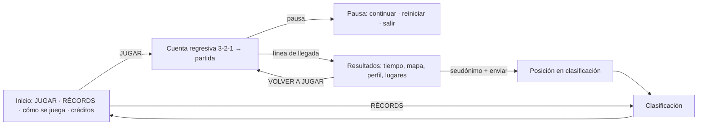

# PROJECT_PLAN.md — Reto Ebéjico: del túnel al pueblo

**Mirada Parda — Laboratorio de pensamiento crítico y humanidades digitales** · Primer juego de la colección
Estado: **Fase 1 completada (investigación y planificación)** · Documentos hermanos: [`SOURCES_AND_LICENSES.md`](SOURCES_AND_LICENSES.md) · [`docs/ARCHITECTURE.md`](docs/ARCHITECTURE.md) · [`docs/GEO_RESEARCH.md`](docs/GEO_RESEARCH.md)

---

## 1. Resumen ejecutivo

**Qué se construye:** un juego arcade de conducción cenital 2D, de **un único recorrido continuo** de ≈ 3–5 minutos, que reproduce **en orden real** la ruta desde la salida occidental del Túnel de Occidente hasta el Parque Principal de Ebéjico, con cronómetro y clasificación pública.

**Decisiones principales (justificadas en las secciones indicadas):**

| Tema | Decisión | Sección |
|---|---|---|
| Vista | **A. Cenital 2D** (cámara fija al norte por defecto, con anticipación) | 3 |
| Motor | **Phaser** (TypeScript, Vite) + **`game-core` independiente del motor** | 4 |
| Interfaz | **DOM/CSS accesible**, no dentro del canvas | 4 |
| Backend | **Supabase** (Postgres + Edge Functions + RLS) tras una interfaz intercambiable; plan B: Cloudflare Workers + D1 | 5 |
| Antitrampas | Partida emitida por servidor + validación temporal + límites + antibot + **reproducción de entradas** (determinista) | `ARCHITECTURE.md` §6 |
| Integración | **iframe** a una ruta estática del mismo hosting de WordPress | `ARCHITECTURE.md` §7 |
| Geografía | Trazado reconstruido desde **OSM** y **Copernicus DEM**; distinción obligatoria *verified / approximate / fictional / pending* | 2 |

**Hallazgo clave de la investigación:** la ruta es **real, larga y muy sinuosa** (≈ 26,1 km desde el portal; ≈ 96 curvas relevantes; 17 de tipo horquilla; descenso neto ≈ 766 m con un valle intermedio y un alto). Jugarla a escala 1:1 (≈ 15 min) sería monótono. La decisión de diseño central es **comprimir la longitud sin alterar la secuencia ni el carácter de las curvas** (sección 6.1).

**Lo que hay que confirmar con ustedes** está en la sección 11 (la más importante: que la meta sea el parque de la **cabecera** y no el de Sevilla, y el nombre popular del cruce).

---

## 2. Estado de la verificación geográfica

Resumen (detalle completo y método en [`docs/GEO_RESEARCH.md`](docs/GEO_RESEARCH.md)):

```
 km 0        Salida occidental del Túnel de Occidente        [verified]  6,32397 N, -75,68689 O
 km 0–6,2    Vía Medellín–San Jerónimo (Ruta 62)             [verified secuencia]
 km 6,19     «Las Partidas» (Desvío hacia Ebéjico)           [verified: cartografía + tradición oral]
             Quebrada La Miserenga ≈ 1,7 km al este          [verified nombre cartográfico]
 km 9,43     «La Sucia»: puente y cuenca baja en el límite   [verified: cartografía + tradición oral]
 km 10–25    La Suiza · La Renta · El Brasil (La Guamala) ·
             Las Brisas · Blanquizal · Campo Alegre ·
             La Holanda · Fátima                             [approximate: por vecindad]
 km 25,65    Calle 19 (Av. La República) → Calle 20          [verified nombres de vía]
 km 26,15    Parque Principal de Ebéjico (Cabecera)          [verified: meta oficial de llegada]
```

* **Verificado:** el túnel (4.643 m), su portal occidental, la secuencia portal $\rightarrow$ Ruta 62 $\rightarrow$ desvío **«Las Partidas»** $\rightarrow$ valle **«La Sucia»** $\rightarrow$ vía a Ebéjico $\rightarrow$ casco urbano (≈ 26,1 km), puentes y quebradas.
* **Meta oficial:** Parque Principal de la Cabecera Municipal de Ebéjico (frente a la iglesia y la alcaldía). El corregimiento de Sevilla queda registrado para futuras ampliaciones y copas de la colección.
* **Clasificación separada:** Los jugadores que utilicen el modo de «Aceleración Asistida» (accesibilidad táctil) contarán con su propio tablero independiente, salvaguardando la tabla general de competición pura y manual.
* **Ruta verificada:** `data/research/ruta_candidata_osm.geojson` (actualizada con los 22 hitos).

---

## 3. Dirección de arte y vista: comparación

Puntuación 1 (malo) – 5 (excelente). Ponderación según sus prioridades: **diversión ×3, fidelidad ×3, aprendizaje ×2, rendimiento ×2, mantenimiento ×1**.

| Criterio | **A. Cenital 2D** | B. Pseudo-3D (tipo *OutRun*) | C. Isométrica |
|---|:-:|:-:|:-:|
| Facilidad de desarrollo | **5** | 3 | 2 |
| Fidelidad del recorrido | **5** | 2 | 4 |
| Rendimiento en equipos modestos | **5** | 4 | 3 |
| Compatibilidad con teléfonos | **5** | 4 | 3 |
| Posibilidades de expansión | 4 | 3 | 4 |
| Calidad/atractivo visual | 4 | 4 | 4 |
| Sensación de velocidad (diversión) | 3 | **5** | 3 |
| Relación con el mapa real (aprendizaje) | **5** | 2 | 3 |
| **Total ponderado (máx. 55)** | **50** | 34,5 | 37,5 |

Cálculo: *diversión* = media(sensación de velocidad, calidad visual) ×3; *fidelidad* ×3; *aprendizaje* = relación con el mapa real ×2; *rendimiento* = media(equipos modestos, teléfonos) ×2; *mantenimiento* = media(facilidad de desarrollo, expansión) ×1. Las puntuaciones son juicio técnico razonado, **no mediciones**: la Fase 2 debe confirmar rendimiento y sensación de conducción.

**Por qué B pierde:** el pseudo-3D de segmentos *finge* las curvas como desplazamientos laterales; **no puede representar horquillas ni cambios de rumbo reales** y rompe la relación con el mapa. Con 17 curvas ≥ 120° la ruta pierde su identidad.
**Por qué C pierde:** exige ordenar profundidades y sprites en varias orientaciones; las curvas cerradas quedan ocultas por relieve/edificios; el costo artístico es el mayor para ganar poco.
**Recomendación: A (su preferencia inicial)**, con tres recursos para compensar la menor sensación de velocidad: (1) *zoom dinámico* que se aleja al acelerar, (2) *anticipación* de cámara en la dirección de marcha, (3) sombras desplazadas y partículas de polvo para sugerir altura.

**Identidad visual propuesta — «cartografía viva»:**
* Terreno coloreado por **bandas altimétricas** y **curvas de nivel generadas del DEM real** (cada línea del suelo es dato verdadero; además es barato de renderizar).
* Paisaje por tramo: bosque tropical, cafetal, cañaduzal, pastos, viviendas rurales, quebradas y puentes, y casco urbano con **identidad propia** (calles, tejados, la plaza).
* UI con tokens reales del portal (extraídos de miradaparda.com): fondo `#0F0F0D`/`#1A1410`, crema `#E8DDC8`/`#F5F0E8`, rojo `#8B1A1A`, dorado/ocre `#C8A96E`, texto suave `#A09880`; títulos en **Cormorant Garamond**; botones de **48 px** y objetivos táctiles de **44 px**, como ya define el portal.
* El mundo del juego puede ser más saturado (verdes, ocres, azules de quebrada) pero con **paleta limitada** para mantener cohesión con la marca.
* El parque de Ebéjico es el **cierre**: la cámara se detiene en la línea de llegada y la pantalla de resultados «se despliega» como un mapa.

---

## 4. Tecnología: comparación y decisión

| Criterio | **Phaser** | Godot 4 (web) | PixiJS + código propio | Canvas2D «a mano» |
|---|---|---|---|---|
| Peso de carga | ≈ 350 KB gzip (dato de fuentes secundarias; **medir en Fase 2**) | **≈ 5 MB gzip** del WASM (fuente secundaria; **medir**) + datos | ≈ 100–150 KB gzip | mínimo |
| Equipos modestos / datos móviles | **Muy bueno** | Aceptable, carga inicial pesada | Muy bueno | Muy bueno |
| Teléfonos | Bueno (WebGL/Canvas) | Más riesgo en iOS/Safari y memoria | Bueno | Bueno |
| Integrar menús DOM, ranking, accesibilidad | **Natural** (mismo documento) | Difícil (el juego es un lienzo opaco; puente JS↔Godot) | Natural | Natural |
| Hosting (WordPress/Hostinger) | Estático, **sin cabeceras especiales** | Estático; en modo *single-thread* sin cabeceras COOP/COEP; con hilos las exige | Estático | Estático |
| Lenguaje compartible con servidor (reproducción) | **TypeScript** → mismo `game-core` en Deno | GDScript: no reutilizable en el servidor | TypeScript | TypeScript |
| Entrega de escenas, carga, input táctil, audio, cámara | Incluida | Incluida (mejor editor) | Hay que escribirla | Hay que escribirla |
| Mantenimiento por una organización pequeña | **Alto** (JS/TS, comunidad amplia, licencia MIT) | Medio (otro entorno/herramientas) | Medio | Bajo a largo plazo |

**Decisión: Phaser + TypeScript + Vite**, con **`game-core` puro** (sin Phaser) para física, pista y repetición.
Razones: (1) el público (estudiantes de un municipio, muchos con datos móviles o equipos modestos) exige **carga ligera**; (2) la UI DOM y la clasificación se integran sin fricción; (3) **un mismo código** simula en el navegador y verifica en el servidor; (4) no se necesita un editor de escenas ni 3D, donde Godot sí aporta valor.
**Matiz de versión:** npm publica Phaser **4.2.1** (MIT) como última versión. Phaser 4 reescribió su render; es reciente. **Plan:** prototipar en la versión estable actual y, si apareciera un problema, retroceder a la rama 3.x. Como `game-core` es independiente, el riesgo está contenido en la capa de render.
**Lo que no se usa:** el motor físico de Phaser (Arcade/Matter) — el vehículo y la colisión contra una polilínea de carretera son más precisos y deterministas con código propio.

**Herramientas del entorno verificadas:** Node 24.20, npm 11.19 (invocar `npm.cmd`: la política de PowerShell bloquea `npm.ps1`), Git 2.55, Python 3.11 **sin** librerías geoespaciales instaladas (se instalarán `shapely`, `pyproj`, `numpy`, `rasterio` en un entorno virtual para la Fase 3), 17 GB libres. No hay Godot instalado (otro motivo menor).

---

## 5. Backend de clasificación: comparación

| Opción | Pros | Contras | Veredicto |
|---|---|---|---|
| **Supabase** (Postgres + Edge Functions + RLS) | SQL real con `rank()`, RLS para lectura pública, funciones en TypeScript/Deno (reutilizan `game-core`), cliente oficial MIT, escalable a toda la colección con un esquema por juego | Plan gratuito: proyecto se **pausa tras inactividad** (verificar) y cuotas de invocaciones (≈ 500 mil/mes según fuentes; **verificar**); CPU de funciones limitada (≈ 2 s; **verificar**) | **Elegido**, con *keep-alive* y interfaz `LeaderboardProvider` para poder migrar |
| Cloudflare Workers + D1/KV + Turnstile | Sin pausas, limitación de tasa/WAF en el borde antes de gastar cuota, mismo proveedor de antibot | SQLite (D1) menos cómodo para rankings complejos; otro ecosistema | **Plan B** (también puede anteponerse a Supabase como filtro) |
| Firebase | Madurez | Vendor lock-in, consultas de ranking menos naturales, reglas más difíciles de auditar | Descartada |
| PHP/MySQL en el hosting de WordPress | Sin proveedor nuevo | Mezcla con el sitio de la organización (riesgo de seguridad), difícil de escalar y de probar | Descartada |

Los límites y precios citados provienen de fuentes secundarias y **deben confirmarse en la documentación oficial** antes de la Fase 5.

---

## 6. Diseño del juego

### 6.1 Compresión del recorrido (decisión central)
La ruta real son ≈ 26,1 km. Con una velocidad media arcade de ≈ 20–25 m/s (en unidades del juego) un 1:1 duraría > 15 min.
* **Meta de duración:** primera partida de principiante 5–7 min; **récord esperado 2:45–3:30**. Se calibrará con pruebas.
* **Método:** a partir de la geometría real se genera una pista jugable que (1) **conserva la secuencia, la orientación general y el ángulo de cada curva relevante**, (2) **comprime las rectas** (donde no pasa nada) mucho más que las curvas, (3) fuerza un **radio mínimo** jugable y un ancho de calzada estilizado, (4) conserva el vínculo punto→`km` real para mostrar progreso y lugares correctos.
* **Honestidad cartográfica:** la pista del juego es una **versión esquemática**; el mapa real de la pantalla final se dibuja con la geometría **sin comprimir**, con la trayectoria y los lugares, para que el estudiante relacione ambos.
* Parámetros editables en `track.config.json` (`escala`, `radio_mínimo`, `compresión_de_rectas`, `ancho_de_calzada`). Riesgo: si al comprimir se pierde el «carácter», se ajusta el parámetro, no el código.

### 6.2 Controles
* **Teclado:** ←/→ o A/D (girar), ↑/W (acelerar), ↓/S (frenar/reversa corta), `P`/`Esc` (pausa), `R` (reiniciar).
* **Táctil:** dos zonas grandes: izquierda = girar a izquierda/derecha (botones o arrastre horizontal); derecha = acelerar/frenar. Opción «**aceleración asistida**» (acelera sola) para accesibilidad; **se marca en el ranking** o va a una categoría aparte (a decidir, §11).
* **Gamepad** opcional (bajo costo con el abstracto `{steer, throttle, brake}`).

### 6.3 Física arcade (parámetros de partida, a afinar por *playtest*)
* Aceleración progresiva con curva suave; frenado fuerte; **inercia moderada** (el coche se desliza un poco al girar fuerte).
* **Giro dependiente de la velocidad:** el ángulo máximo baja al subir la velocidad (se premia frenar antes de la horquilla).
* **Pendiente:** bajada acelera (+10–15 %), subida frena; da sentido al perfil real.
* **Fuera de calzada:** berma = ligera pérdida (≈ −10 %); vegetación/talud = fuerte arrastre; **barrera o abismo** = rebote o *reaparición* en el último punto seguro con **penalización fija de 2–3 s** (no pierde el progreso, no se frustra).
* Colisiones suaves: se pierde velocidad, no se «muere». **Ningún choque reinicia la partida.**
* **Recuperación:** botón «volver a la carretera» con la misma penalización fija (evita quedarse atascado).

### 6.4 Dificultad y variedad (sin pista de carreras ficticia)
* Tramos con carácter derivado de los datos: **bajada inicial** (frenar), **valle** (curvas y cruces), **subida larga** (mantener ritmo), **alto** (curvas abiertas), **bajada final** (ganar tiempo) y **entrada urbana** (calles estrechas).
* **Obstáculos ocasionales y verosímiles** (todos `fictional` y señalados así en las fuentes): vehículos lentos (camión, chiva, moto), un vehículo detenido en la berma, piedras sueltas de pequeño derrumbe, ganado en un tramo rural. **Sin tráfico de frente continuo** al inicio (se evaluará en *playtest*).
* **Atajos y tramos «de ganar tiempo»:** calzadas más anchas donde se puede «cortar» la curva con riesgo moderado; rectas descendentes.
* Cada obstáculo se coloca por datos (`segments.json`): reproducible y calibrable.

### 6.5 Pedagogía integrada (sin clase)
* **Cinta de ruta** en el HUD: una línea fina con los lugares como marcas (como un diagrama de transporte). El estudiante *ve* la secuencia sin leer.
* **Rótulos viales discretos** (estilo señal colombiana de carretera) que aparecen 2 s al pasar un lugar: «Cruce a Ebéjico», nombre de quebrada, vereda. **Nunca pausan el juego.** Máximo un rótulo a la vez.
* **Referencias visuales** únicas por lugar (silueta del portal del túnel, puente, entrada al pueblo, plaza).
* **Contador «Lugares reconocidos X/N»** (por haberlos pasado, no por responder).
* **Pantalla de resultados:** (1) tiempo, (2) posición, (3) **mapa del recorrido completo** con la trayectoria, (4) **lugares** como lista breve con etiqueta de fidelidad, (5) **perfil de elevación simplificado** con marcas, (6) **«Dónde queda Ebéjico»**: mapa-locator Colombia → Antioquia → Occidente y una frase de cómo llegar desde Medellín. Todo SVG propio generado del GeoJSON.
* Sin preguntas obligatorias ni textos largos.

### 6.6 Flujo de usuario

La clasificación se ve **antes de jugar** (inicio), **después de terminar** (resultados) y en **sección independiente**. Se evita cualquier otro menú.

### 6.7 Accesibilidad y teléfonos
* Contraste AA, tamaños mínimos del portal (texto ≥ 14 px, objetivos táctiles ≥ 44 px), foco visible, navegación completa por teclado en menús, `prefers-reduced-motion`, sin destellos, información no solo por color (patrones en el mapa), subtítulos o equivalentes para cualquier audio informativo.
* Diseño **escritorio primero**, pero horizontal en móvil con prueba real; si el tamaño de pantalla es insuficiente, se pide girar. Modo de calidad **baja** automático según FPS.

---

## 7. Arquitectura y estructura de carpetas
Ver [`docs/ARCHITECTURE.md`](docs/ARCHITECTURE.md) (diagramas, estructura, módulos, esquemas de datos, flujo de clasificación, integración con WordPress). Aspectos clave:
1. **`game-core`** (TS puro, determinista) compartido por navegador y servidor.
2. **`track-data`** como archivos independientes y reutilizables (`route.geojson`, `pois.json`, `segments.json`, `elevation.json`) con esquema y validación.
3. **Interfaz DOM** accesible, separada del juego.
4. **`leaderboard-sdk`** con proveedor intercambiable (Supabase / simulado para pruebas sin conexión).
5. **`mp-games-shared`** reservado para la colección.

---

## 8. Privacidad y seguridad
* Sin nombres reales, correos, teléfonos ni documentos. Solo **seudónimo**; filtro de datos personales en seudónimos.
* Identidad por **token aleatorio local** (se guarda su hash) y **código de recuperación** opcional; sin cuentas.
* IP **no almacenada en claro** (hash con sal rotatoria, retención corta).
* Claves privadas solo en el servidor. Cliente: URL pública y clave *anon* con RLS de solo lectura.
* Sin publicidad, sin rastreadores de terceros, tipografías autoalojadas. Marco legal de referencia: **Ley 1581 de 2012** y **Decreto 1377 de 2013** (datos de menores). Se recomienda **revisión legal** de la política de privacidad antes de publicar.

---

## 9. Riesgos técnicos y mitigaciones

| # | Riesgo | Prob. | Impacto | Mitigación |
|---|---|:-:|:-:|---|
| 1 | **Datos de ruta incorrectos o desactualizados en OSM** | M | Alto | Doble fuente (extracto OSM + OSRM), contraste satelital abierto, **revisión comunitaria** en Ebéjico |
| 2 | **Compresión de la pista «aplana» el carácter de la ruta** | M | Alto | Parámetros calibrables, *playtests*, comparación de curvas clave contra la geometría real |
| 3 | **Nombres de lugares no verificables** (cruce, quebradas, puentes) | A | Medio | Etiqueta `pending`: **no se muestran** hasta verificarlos |
| 4 | Conducción poco divertida | M | Alto | **Fase 2 dedicada a sentir la conducción** antes de invertir en arte/datos; criterios de salida de *playtest* |
| 5 | Rendimiento en móviles modestos | M | Alto | Terreno por *chunks* pre-renderizados, pocos sprites, calidad adaptable, presupuesto de carga < 1,5 MB, prueba en equipos reales |
| 6 | Trampas (bots, tiempos fabricados) | A | Medio | Capas del servidor + reproducción; moderación; limitaciones documentadas |
| 7 | Determinismo de la reproducción entre motores JS | M | Medio | Trig propia o tolerancia; pruebas cruzadas Chrome/Firefox/Safari |
| 8 | Límites/pausa del plan gratuito de Supabase | M | Medio | *Keep-alive*, tabla pública cacheada, plan B Cloudflare, abstracción |
| 9 | Datos de menores y cumplimiento legal | B | Alto | Cero datos personales; revisión legal; moderación de seudónimos |
| 10 | Licencias (ODbL *share-alike*, atribuciones) | M | Medio | Registro de activos desde el día 1; datos ODbL separados del código |
| 11 | Integración con WordPress (cachés, optimizadores) | M | Bajo | iframe aislado; prueba temprana en un entorno de ensayo |
| 12 | Phaser 4 es reciente | B-M | Medio | `game-core` independiente; retroceso a 3.x posible |
| 13 | Dependencia de servicios públicos (Overpass/Nominatim/OSRM) | A | Bajo | Solo en investigación; producción usa archivos locales |
| 14 | Alcance excesivo | A | Alto | MVP estricto por fases, ver §10 |

---

## 10. Plan por fases (con proyecto funcional al cierre de cada una)

Estimaciones **orientativas** en sesiones de trabajo enfocado (no calendarios).

### FASE 1 — Investigación y planificación ✅
Entregables: este documento, `SOURCES_AND_LICENSES.md`, `docs/ARCHITECTURE.md`, `docs/GEO_RESEARCH.md`, `data/research/ruta_candidata_osm.geojson`, scripts reproducibles en `tools/research/`.

### FASE 2 — Prototipo jugable (≈ 4–6 sesiones)
* Monorepo mínimo (`game-core`, `game-client`, `apps/reto-ebejico`), Vite + TS + Phaser, Vitest.
* Pista **provisional y ficticia (rotulada «PISTA DE PRUEBA»)** con curvas, horquillas y una recta.
* Vehículo, física, colisiones con la polilínea, penalizaciones, pendiente sintética, cámara con zoom/anticipación.
* Teclado y táctil; cronómetro por pasos; cuenta regresiva; meta; resultado simple; reinicio inmediato; **registro de entradas** (base del antitrampas).
* **Criterios de salida:** conduce de forma ágil (revisión por ≥ 5 personas); se puede mejorar el tiempo con práctica (diferencia entre 1.ª y 5.ª partida ≥ 15 %); 60 FPS en un equipo modesto y fluidez en un teléfono real; medición de peso real de carga; la simulación corre en Node con resultados idénticos (determinismo básico).

### FASE 3 — Reconstrucción geográfica (≈ 6–9 sesiones)
* `geo-pipeline`: extracto OSM → cadena de *ways* → `route.geojson` validado contra la ruta candidata; puentes y quebradas (`crossings.json`); veredas/límites (DANE/IGAC); elevación GLO-30 → `elevation.json`; pista jugable (`route.game.json`) con compresión.
* `pois.json` y `segments.json` con fidelidad/fuente; **revisión con docentes/estudiantes de Ebéjico**.
* Sustituir la pista provisional; cinta de ruta y rótulos.
* **Criterios de salida:** trazado coincide con OSM (< 15 m en > 98 %); cada POI con fuente; ningún POI `pending` visible; la secuencia de curvas principal se reconoce frente al mapa real; duración de partida dentro de la meta.

### FASE 4 — Diseño visual y rendimiento (≈ 8–12 sesiones)
* Terreno hipsométrico + curvas de nivel; sets de paisaje (bosque, cafetal, cañaduzal, pasto, viviendas, quebrada/puente, casco urbano); parque de Ebéjico como cierre; vehículo(s); audio ligero.
* UI con identidad Mirada Parda; pantallas de inicio, pausa, resultados (mapa SVG + perfil SVG + locator).
* Optimización: *chunks*, atlas de sprites, calidad adaptable, carga diferida.
* **Criterios de salida:** presupuesto de carga < 1,5 MB; ≥ 45 FPS en móvil de gama media; revisión visual y de marca.

### FASE 5 — Clasificación en línea (≈ 5–7 sesiones)
* 5a: esquema SQL, RLS, `start-run`/`finish-run`/`board`, SDK, UI del ranking (antes/después/independiente), seudónimos y moderación, límites y antibot.
* 5b: **reproducción de entradas en el servidor** con `game-core`.
* **Pruebas de seguridad y consistencia:** envíos duplicados, tiempos imposibles, reutilización de `run_id`, spam, inyección, lectura/escritura prohibida con clave *anon*, carga concurrente, consistencia del ranking y desempates.
* **Criterios de salida:** ninguna escritura posible con la clave pública; todas las pruebas negativas rechazadas; ranking consistente bajo concurrencia.

### FASE 6 — Pruebas y publicación (≈ 4–6 sesiones)
Controles, rendimiento, compatibilidad (Chrome/Firefox/Safari/Edge, Android/iOS), experiencia móvil, registro de récords, integridad, **auditoría de licencias**, accesibilidad (revisión manual + herramientas), documentación `HOWTO_*`, compilación y publicación del iframe en el portal; prueba piloto con estudiantes.

### Alcance del MVP (v1.0) y ampliaciones
**Dentro del v1.0:** una pista, un vehículo, ranking global, resultados con mapa/perfil, teclado + táctil.
**Fuera del v1.0 (propuestas simples si el alcance crece):** varios vehículos, fantasmas de otros jugadores, temporadas, modo asistido separado, clima/hora del día, tablas por colegio, otros recorridos (segundo juego de la colección).

---

## 11. Preguntas abiertas (necesito sus decisiones)

1. **Meta:** ¿confirman que el final es el **Parque Principal de la cabecera** (≈ 6,3264 N, −75,7685 O) y **no** el parque de Sevilla (≈ 6,2939 N, −75,7850 O)? ¿Quieren la línea de llegada **en el borde del parque** o en la calle de acceso?
2. **«La Miserenga»:** en los datos aparece como **quebrada** y **reserva**, a ≈ 1,7 km de la vía, **no** como nombre del cruce. ¿Hay fuente local que llame así al sitio del desvío? Si no, se rotula como «Cruce hacia Ebéjico» y se presenta la quebrada solo si la vía realmente la cruza.
3. **Revisión local:** ¿pueden contar con docentes/estudiantes de Ebéjico para corregir nombres de veredas y lugares reconocibles (Fase 3)?
4. **Aceleración asistida:** ¿va a la misma clasificación (marcada) o a otra categoría?
5. **Licencias:** ¿MIT para el código y ODbL/CC BY para datos y contenido, como se propone en `SOURCES_AND_LICENSES.md` §6?
6. **Backend:** ¿tienen cuenta de Supabase/Cloudflare, o la crean ustedes? ¿Se acepta un plan gratuito con *keep-alive* para el piloto?
7. **Hosting:** ¿se puede subir una carpeta estática (`/juegos/reto-ebejico/`) al hosting del portal y quién la administra?
8. **Donaciones:** ¿qué plataforma usarán para el apoyo voluntario (enlace externo)? El juego solo enlazará.

> **Siguiente paso propuesto:** con sus respuestas a 1, 2 y 4–7, iniciar la **Fase 2** (prototipo con pista de prueba) sin esperar a las demás.
