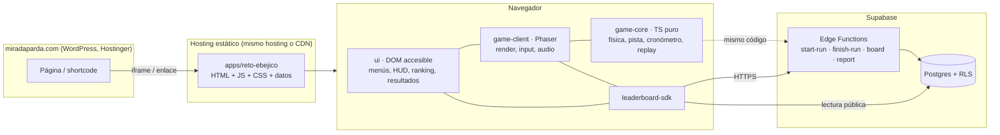

# ARCHITECTURE.md — Reto Ebéjico

Propuesta de arquitectura y estructura de carpetas (Fase 1). Principio rector: **el juego, los datos del territorio, la interfaz y la clasificación son piezas separadas**, para que Reto Ebéjico sea el primero de una colección y no un experimento aislado.

## 1. Vista general



* **`game-core` es independiente de Phaser y del DOM.** Contiene vehículo, física, colisiones, geometría de pista, cronómetro y registro/reproducción de entradas. Corre igual en el navegador, en pruebas automáticas y en el servidor (Deno/Edge Function) para **verificar partidas por reproducción**.
* **La interfaz es DOM** (HTML/CSS), no canvas: accesible (lectores de pantalla, foco, tamaños de texto), fácil de integrar con la identidad de Mirada Parda y barata en rendimiento.
* **Los datos territoriales son archivos JSON/GeoJSON versionados** (`track-data`), independientes del código. Cambiar el recorrido o los puntos de interés no exige tocar código.
* **El cliente nunca tiene claves privadas.** Solo la URL pública del proyecto y la clave *anon* (de solo lectura bajo RLS). Escrituras solo vía Edge Functions.

## 2. Estructura de carpetas

```
reto-ebejico/                      (monorepo con npm workspaces)
├─ README.md
├─ PROJECT_PLAN.md
├─ SOURCES_AND_LICENSES.md
├─ LICENSE · LICENSE-DATA (ODbL) · LICENSE-CONTENT (CC BY)
├─ docs/
│  ├─ ARCHITECTURE.md · GEO_RESEARCH.md
│  ├─ HOWTO_track.md              cómo cambiar la geometría
│  ├─ HOWTO_pois.md               cómo editar puntos de interés
│  ├─ HOWTO_vehicles.md · HOWTO_scenery.md
│  ├─ HOWTO_difficulty.md · HOWTO_leaderboard.md
│  └─ SECURITY.md · PRIVACY.md · ACCESSIBILITY.md
├─ apps/
│  └─ reto-ebejico/               entrada web (index.html, vite.config, i18n, créditos)
├─ packages/
│  ├─ game-core/                  TS puro, determinista, sin DOM/Phaser
│  │  └─ src/ vehicle/ physics/ collision/ track/ timer/ replay/ rng/ config/
│  ├─ game-client/                Phaser: escenas, cámara, render, input, audio
│  │  └─ src/ scenes/ render/ scenery/ input/ audio/ hud-bridge/
│  ├─ ui/                         menús, HUD DOM, ranking, resultados, mapa SVG, perfil SVG
│  │  └─ src/ screens/ components/ i18n/ a11y/ styles/ (tokens Mirada Parda)
│  ├─ leaderboard-sdk/            interfaz LeaderboardProvider + SupabaseProvider + MockProvider
│  ├─ track-data/                 ← DATOS (reutilizables, con esquema y validador)
│  │  ├─ route.geojson            geometría real simplificada (ODbL)
│  │  ├─ route.game.json          pista jugable derivada (generada, no se edita a mano)
│  │  ├─ pois.json                puntos de interés (con etiqueta de fidelidad y fuente)
│  │  ├─ segments.json            tramos: paisaje, cobertura, dificultad, obstáculos
│  │  ├─ elevation.json           perfil y pendientes
│  │  ├─ crossings.json           puentes y quebradas verificados
│  │  ├─ sources.json             referencias → SOURCES_AND_LICENSES.md
│  │  └─ schema/                  JSON Schema de cada archivo
│  └─ mp-games-shared/            (futuro) identidad, componentes y SDK comunes a toda la colección
├─ backend/
│  └─ supabase/
│     ├─ migrations/              tablas, vistas, políticas RLS, funciones SQL
│     ├─ functions/               start-run · finish-run · board · report (Deno)
│     └─ tests/                   pruebas de seguridad y consistencia
├─ tools/
│  ├─ research/                   (existente, Fase 1) sondas Nominatim/OSRM/Overpass
│  └─ geo-pipeline/               OSM+DEM → route.geojson → route.game.json → elevation.json
├─ portal-integration/            snippet WordPress (iframe/shortcode), contrato postMessage
└─ data/
   ├─ raw/                        descargas crudas (no se publican)
   └─ research/                   salidas de investigación (ruta candidata)
```

Cada futuro juego será `apps/<juego>` + su `track-data` equivalente; reutiliza `ui`, `leaderboard-sdk` y `mp-games-shared`.

## 3. Módulos y responsabilidades (mapa con los requisitos del encargo)

| Requisito | Módulo | Notas |
|---|---|---|
| Motor y lógica del juego | `game-core` + `game-client/scenes` | Bucle de paso fijo a 60 Hz; render interpolado |
| Control del vehículo | `game-core/vehicle` + `game-client/input` | Entrada abstracta: `{steer, throttle, brake}` (teclado/táctil/gamepad) |
| Física y colisiones | `game-core/physics`, `game-core/collision` | Distancia a la polilínea de la carretera con índice espacial; sin motor físico externo |
| Geometría de la carretera | `game-core/track` + `track-data/route.game.json` | Polilínea suavizada + ancho por tramo |
| Escenarios y elementos visuales | `game-client/scenery` + `segments.json` | Terreno por «chunks» pre-renderizados; dispersión de sprites por cobertura |
| Datos geográficos | `track-data` + `tools/geo-pipeline` | Generados desde fuentes con trazabilidad |
| Puntos de interés | `track-data/pois.json` | Cada POI: `id, nombre, tipo, lat, lon, km, fidelidad, fuente, texto_corto` |
| Cronómetro | `game-core/timer` | Tiempo = pasos de simulación × 1/60 s (no `Date.now`) |
| Interfaz | `ui` | DOM + tokens Mirada Parda |
| Sistema de resultados | `ui/screens/results` + `game-core/replay` | Mapa, perfil, lugares identificados, posición |
| Clasificación | `leaderboard-sdk` + `backend/supabase` | |
| Conexión con backend | `leaderboard-sdk/SupabaseProvider` | Intercambiable por otro proveedor |
| Configuración y créditos | `apps/reto-ebejico/config`, `ui/screens/credits` | Créditos generados desde `sources.json` |

## 4. Datos: esquemas mínimos

`pois.json` (extracto ilustrativo — **valores de ejemplo reales de la Fase 1, aún `pending` donde se indica**):
```json
{
  "id": "portal-occidental",
  "name": "Salida occidental del Túnel de Occidente",
  "type": "gateway",
  "lat": 6.32397, "lon": -75.68689,
  "route_km": 0.0,
  "fidelity": "verified",
  "sources": ["osm:way/42785427"],
  "short_text": "Aquí empieza el recorrido hacia Ebéjico."
}
```
```json
{
  "id": "cruce-ebejico",
  "name": "Cruce hacia Ebéjico",
  "type": "junction",
  "lat": 6.36107, "lon": -75.70865,
  "route_km": 6.19,
  "fidelity": "verified",
  "name_status": "pending",
  "sources": ["osm:routing"],
  "short_text": "Sales de la vía Medellín–San Jerónimo y tomas la vía a Ebéjico."
}
```
`segments.json`: `{ "from_km", "to_km", "landcover", "scenery_set", "road_width", "difficulty", "obstacles":[...], "fidelity" }`.

## 5. Física y pista (resumen técnico)

* **Paso fijo 60 Hz**, entradas muestreadas por paso; render interpolado a la frecuencia de la pantalla.
* **Vehículo** (modelo arcade de «bicicleta» simplificado): velocidad escalar + rumbo + deslizamiento lateral amortiguado; dirección reducida con la velocidad; arrastre fuera de calzada; pendiente que modifica aceleración ±.
* **Colisión con la carretera:** se calcula la distancia firmada a la polilínea (índice por celdas o BVH de segmentos). Zonas: calzada → berma → talud/vegetación (arrastre) → barrera/abismo (rebote o reaparición con penalización fija y breve).
* **Pista jugable** (`route.game.json`): generada por `geo-pipeline` a partir de `route.geojson`: (1) simplificar (Douglas-Peucker con tolerancia por curvatura), (2) suavizar (spline) respetando **radio mínimo** jugable, (3) **comprimir longitud** de rectas conservando la secuencia y el ángulo de cada curva, (4) vincular cada punto del juego con su `km` real. Los parámetros (`escala`, `radio_mínimo`, `compresión_de_rectas`) están en un único `track.config.json`.
* **Determinismo:** funciones trigonométricas pueden diferir en el último bit entre motores JS. Se mitiga con **tablas/aproximaciones propias** en `game-core` o con tolerancias en la verificación (ver §6).

## 6. Clasificación en línea y antitrampas

### Flujo
```mermaid
sequenceDiagram
  participant C as Cliente
  participant S as Edge Function
  participant D as Postgres
  C->>S: POST start-run {player_token?, version, track_hash}
  S->>D: crea run (id, started_at servidor, nonce, ip_hash)
  S-->>C: {run_id, run_token firmado (HMAC)}
  Note over C: juega; registra entradas comprimidas<br/>y tiempos de checkpoints
  C->>S: POST finish-run {run_id, run_token, client_time, inputs, checkpoints, nickname, turnstile}
  S->>S: valida token, estado, tiempos, límites, antibot
  S->>S: REPRODUCE inputs con game-core (Fase 5b)
  S->>D: guarda run + upsert mejor tiempo del jugador
  S-->>C: {accepted, rank, personal_best, top_n}
```

### Validaciones del servidor (por capas)
1. **Identificador de partida de un solo uso**, emitido por el servidor al iniciar; caduca (p. ej. 20 min).
2. **Tiempos del servidor:** `server_elapsed = finish_at − started_at`. Se exige `client_time ≤ server_elapsed + ε` y `server_elapsed − client_time ≤ margen de carga` (el cliente no puede declarar menos tiempo del que de verdad pasó, ni «inventar» una partida de 2 s).
3. **Cotas físicas:** tiempo mínimo teórico (simulación de «piloto perfecto» × 0,9) y máximo (p. ej. 20 min).
4. **Checkpoints monótonos y plausibles:** cada tramo con velocidad media entre cotas mínima/máxima.
5. **Versión y huella de la pista** (`track_hash`): se rechazan partidas de versiones antiguas.
6. **Límites de frecuencia:** por `player_token` y por `ip_hash` (hash con sal rotatoria; no se guarda la IP en claro); máximo de partidas iniciadas y envíos por hora/día.
7. **Antibots:** prueba invisible (Turnstile o Altcha) **solo al enviar un récord**, para no interrumpir el juego.
8. **Seudónimos:** 3–16 caracteres, filtro de groserías y de patrones de datos personales (correos, teléfonos, URLs, números largos), lista de bloqueo; botón «reportar»; retiro manual desde panel de administración.
9. **Reproducción de entradas (Fase 5b):** el servidor ejecuta `game-core` con las entradas y exige que el resultado coincida con el tiempo declarado dentro de una tolerancia. Es la defensa más fuerte contra tiempos fabricados.

### Modelo de datos (esquema `reto_ebejico`)
`players(id, token_hash, nickname, created_at, banned)` · `runs(id, player_id, started_at, finished_at, client_ms, verified_ms, status, game_version, track_hash, ip_hash, checkpoints jsonb)` · `best_times` (vista/tabla materializada: mejor tiempo por jugador, con `rank() over (order by verified_ms, achieved_at)`) · `reports(id, run_id, reason, created_at)`.
**RLS:** lectura pública solo de `best_times_public` (vista sin `ip_hash` ni `token_hash`); **sin** permisos de escritura para `anon`; escrituras únicamente por Edge Functions con la clave de servicio (variable de entorno del servidor).

### Identidad sin datos personales
* El primer récord crea un `player_token` aleatorio (128 bits) guardado en `localStorage`; el servidor solo guarda su hash. El seudónimo queda **reservado** a ese token.
* **Código de recuperación** opcional (frase aleatoria de palabras) para continuar en otro dispositivo; sin correo.
* «Mejor tiempo personal» se muestra en la fila del propio jugador y en «Mi historial» (último vs. mejor).

### Limitaciones honestas del antitrampas
* Un cliente web **no es confiable**: cualquier atacante determinado puede escribir un bot que conduzca «perfecto» y envíe entradas válidas. La reproducción lo vuelve **costoso**, no imposible.
* La reproducción exige determinismo suficiente; con tolerancias se pueden colar diferencias mínimas (< 0,05 s).
* Los límites por IP afectan a redes compartidas (colegios con una IP pública). Los umbrales deben ser generosos y basados también en `player_token`.
* Moderación: seudónimos y récords sospechosos se retiran manualmente; se conserva registro.
* Plan de contingencia: temporadas/tablas mensuales y «reinicio» de tabla si se comprometiera.

## 7. Integración en Mirada Parda

El portal es **WordPress** (tema Blocksy, LiteSpeed, PHP 8.2). Opciones evaluadas:

| Opción | Pros | Contras | Decisión |
|---|---|---|---|
| **A. Iframe a `/juegos/reto-ebejico/` (estático en el mismo hosting)** | Aislamiento total de CSS/JS del tema, cero conflicto con plugins de caché, un solo dominio | Altura/scroll del iframe; compartir estado con el portal vía `postMessage` | **Recomendada** |
| B. Shortcode que inyecta el bundle en la página | Integración visual total | Riesgo de choques con LiteSpeed/optimizadores, estilos del tema, depuración difícil | Descartada por ahora |
| C. Subdominio `juegos.miradaparda.com` | Separación de despliegue | DNS/SSL adicionales | Alternativa si el hosting limita |

* No se requieren cabeceras especiales (COOP/COEP) porque Phaser no necesita `SharedArrayBuffer`.
* Contrato `postMessage` mínimo: `ready`, `run_finished {time}`, `open_leaderboard`, `donate_click`.
* Enlaces: «Un proyecto de Mirada Parda…», enlace a `https://www.miradaparda.com` y botón discreto de apoyo voluntario (nunca bloquea funciones).

## 8. Despliegue y operación
* Build: `npm run build` → `dist/` estático (HTML+JS+CSS+JSON+sprites) con *hash* en los nombres.
* Presupuesto de carga: **< 1,5 MB** transferidos para primer juego jugable (objetivo), compresión gzip/Brotli; carga diferida de audio y decoración.
* Backend: Supabase (proyecto separado por entorno: `dev`, `prod`). Migraciones versionadas. *Keep-alive* programado si se usa el plan gratuito (los proyectos gratuitos se pausan tras una semana sin actividad — **verificar condiciones vigentes**).
* Observabilidad mínima: contadores de partidas iniciadas/aceptadas/rechazadas y motivo, sin datos personales.
